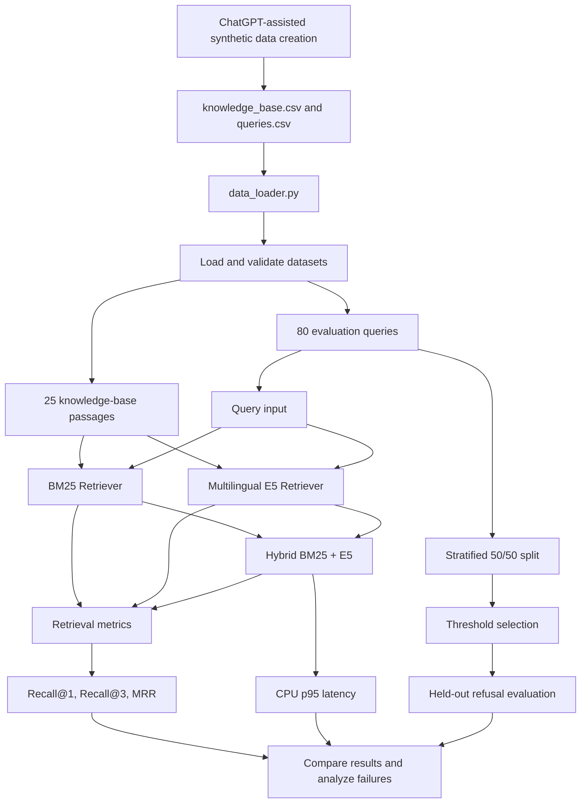

# Loan Retrieval Evaluation: BM25 vs. Multilingual E5 vs. Hybrid Retrieval

## 1. Project Overview

This project evaluates retrieval methods for a fictional loan-servicing voice agent. The goal is to retrieve the correct knowledge-base passage when customers ask questions in English, Hinglish, or noisy speech-recognition text.

Three retrieval systems are compared:

- **BM25:** Lexical retrieval based on matching query and passage terms.
- **Multilingual E5:** Semantic retrieval using text embeddings.
- **Hybrid BM25 + E5:** Combines lexical and semantic retrieval signals.

The evaluation measures retrieval quality, CPU latency, retrieval failures, and the ability to refuse questions that cannot be answered from the knowledge base.

The objective is to make an evidence-based engineering decision rather than assume that a more complex retrieval system is necessarily better.

## 2. Dataset Creation

The dataset represents a fictional loan-servicing company named Nivara Finance. All company policies, charges, and servicing information are synthetic.

ChatGPT was used to assist in drafting the knowledge-base passages and customer queries. The generated content was organized into CSV files for evaluation.

### Knowledge base

The knowledge base contains 25 passages covering:

- EMI schedules and repayment preparation
- Payment methods and bounced payments
- Foreclosure and part-payment
- Loan statements and interest certificates
- Customer support and general servicing

Each passage contains a unique ID, a topic, and its text.

### Query dataset

The evaluation dataset contains 80 queries, divided equally into four categories.

| Query type | Queries | Purpose |
|---|---:|---|
| `english_clean` | 20 | Standard English questions |
| `hinglish` | 20 | Hindi-English code-switching |
| `asr_noisy` | 20 | Informal, misspelled, or transcription-like queries |
| `out_of_scope` | 20 | Questions that cannot be answered from the knowledge base |
| **Total** | **80** | |

Each query has an ID, query text, expected relevant passage ID, and query type. The expected passage ID is left empty for out-of-scope questions.

The dataset deliberately includes similar topics, such as foreclosure charges and part-payment charges, to test whether retrieval distinguishes related but different customer intents.

### AI usage and data validation

ChatGPT assisted with drafting synthetic passages and candidate queries. The dataset is intended for experimentation, not as verified financial guidance.

Before submission, the dataset should be checked for valid CSV structure, unique IDs, correct passage references, appropriate query categories, and empty relevance labels for out-of-scope queries. Document the actual corrections made during review rather than claiming changes that were not performed.

## 3. Architecture and Execution Flow

The project implements the retrieval and evaluation stage of a voice-agent pipeline.



### Step-by-step workflow

1. **Create the dataset:** Prepare 25 synthetic passages and 80 labelled queries.
2. **Load the data:** `data_loader.py` reads the CSV files and validates the required data.
3. **Build BM25:** `BM25Retriever` ranks passages using lexical matching.
4. **Build multilingual E5:** `EmbeddingRetriever` encodes passages and queries into embeddings and ranks passages by semantic similarity.
5. **Build the hybrid retriever:** `HybridRetriever` combines lexical and semantic retrieval according to the implementation in `retrievers.py`.
6. **Evaluate retrieval:** `evaluate.py` measures Recall@1, Recall@3, and MRR for each system and query category.
7. **Measure latency:** The hybrid retriever's warm-search p95 CPU latency is measured and compared with the 150 ms target.
8. **Select a refusal threshold:** A reproducible, stratified half of the queries is used to select a score threshold by maximizing balanced accuracy.
9. **Evaluate refusal behaviour:** The selected threshold is evaluated on the held-out half of the queries.
10. **Investigate failures:** Queries whose expected passages are missing from the top three results are examined to identify weaknesses in retrieval.

The implementation evaluates retrieval; it does not implement the complete speech-recognition, LLM response-generation, or text-to-speech pipeline.

## 4. Evaluation Metrics

- **Recall@1:** Percentage of answerable queries for which the expected passage ranks first.
- **Recall@3:** Percentage of answerable queries for which the expected passage appears within the top three results.
- **Mean Reciprocal Rank (MRR):** Measures how highly the expected passage is ranked, assigning greater value to higher-ranked results.
- **Macro-average:** The arithmetic mean of the metric values across `english_clean`, `hinglish`, and `asr_noisy`, giving each category equal weight.
- **p95 latency:** The 95th-percentile warm-search latency, measured in milliseconds.

Out-of-scope queries are excluded from standard retrieval metrics because they have no designated relevant passage.

## 5. Retrieval Results

The following results are from the recorded evaluation run.

| Query type | Retrieval system | Recall@1 | Recall@3 | MRR |
|---|---|---:|---:|---:|
| English clean | BM25 | 0.850 | 1.000 | 0.925 |
| English clean | Multilingual E5 | 0.850 | 0.950 | 0.897 |
| English clean | Hybrid | 0.800 | 0.950 | 0.887 |
| Hinglish | BM25 | 0.500 | 0.600 | 0.610 |
| Hinglish | Multilingual E5 | 0.650 | 0.850 | 0.750 |
| Hinglish | Hybrid | 0.400 | 0.700 | 0.605 |
| ASR noisy | BM25 | 0.600 | 0.850 | 0.742 |
| ASR noisy | Multilingual E5 | 0.600 | 0.800 | 0.739 |
| ASR noisy | Hybrid | 0.600 | 0.850 | 0.739 |

### Overall macro-average

| Retrieval system | Recall@1 | Recall@3 | MRR |
|---|---:|---:|---:|
| BM25 | 0.650 | 0.817 | 0.759 |
| Multilingual E5 | **0.700** | **0.867** | **0.795** |
| Hybrid | 0.600 | 0.833 | 0.744 |

### Interpretation

Multilingual E5 achieves the strongest overall macro-average results. It also performs best on Hinglish queries, where lexical overlap with the English passages can be limited.

BM25 performs particularly well on clean English queries and remains competitive on noisy ASR-style queries.

**The hybrid approach did not consistently improve retrieval quality.** Its overall results are lower than those of either standalone system in this run. This suggests that the current combination of lexical and semantic scores may need further investigation rather than assuming that combining both methods will improve performance.

## 6. CPU Latency

| Measurement | Result |
|---|---:|
| Queries measured | 80 |
| Warm-search p95 latency | 38.99 ms |
| Target latency | 150 ms |
| Outcome | Within target |

The measurement excludes model initialization and includes query embedding generation where applicable.

The recorded hybrid latency is below the target by 111.01 ms. However, latency depends on the execution environment and is not a guarantee of production performance.

## 7. No-Answer Threshold

A retriever can return a passage even when a query is unrelated to the knowledge base. A score threshold provides a simple mechanism for refusing queries whose highest retrieval score is too low.

### Method

- Split the dataset reproducibly into 40 threshold-selection queries and 40 held-out test queries.
- Select the threshold using balanced accuracy on the selection split.
- Evaluate the chosen threshold on the held-out split.

Balanced accuracy gives equal weight to the correct-refusal rate for out-of-scope queries and the acceptance rate for answerable queries.

### Recorded results

| Measurement | Result |
|---|---:|
| Selection queries | 40 |
| Held-out queries | 40 |
| Selection balanced accuracy | 0.817 |
| Selected threshold | 0.03226226 |
| Out-of-scope queries correctly refused | 6/10 (60.0%) |
| Answerable queries wrongly refused | 4/30 (13.3%) |

### Decision and trade-off

For a live voice agent, returning an unrelated passage as though it answers the customer is particularly risky because it can cause the agent to communicate incorrect financial information. However, refusing an answerable question also harms the customer experience.

The threshold therefore needs to balance both risks. In this experiment, 60% of held-out out-of-scope queries are correctly refused, while 13.3% of answerable queries are incorrectly refused. These results show that the current threshold is not sufficient for reliable production use.

The threshold is specific to this retriever and dataset; retrieval scores are not calibrated probabilities of correctness.

## 8. Retrieval Failure Analysis

The following examples are from the recorded evaluation run. Each expected passage was missing from the retrieved top three.

| Query ID | Query | Expected passage | Retrieved top three | Suspected cause |
|---|---|---|---|---|
| q008 | Can I pay my EMI in cash at a branch? | P08 | P03, P20, P11 | The query's cash-payment intent may be outweighed by general repayment-related terms. |
| q021 | Mera EMI har mahine kis date ko katega? | P01 | P03, P02, P04 | The informal Hinglish wording may not align closely with the English passage wording. |
| q026 | Online loan repayment kaise karun? | P06 | P07, P08, P11 | Related repayment passages may rank above the passage describing the portal payment option. |
| q032 | Loan jaldi band karne ka kitna charge lagega? | P12 | P10, P17, P15 | Similar financial-charge and loan-payment terminology may confuse foreclosure with other charges. |
| q049 | emi bounce matlab payment fail hua na | P09 | P10, P20, P04 | The retriever may match bounce-related terms but rank the fee passage above the definition of a bounced EMI. |

These are hypotheses based on the query wording and returned passages, not confirmed explanations of the retrievers' internal behaviour.

### What did not work?

The hybrid approach was intended to combine the strengths of lexical and semantic retrieval. However, it did not outperform the individual systems consistently and achieved the lowest overall Recall@1 and MRR in this run.

The next experiment would investigate the score-fusion method, including whether lexical and semantic scores require normalization before combination. This is a proposed improvement, not a feature claimed to have been implemented.

## 9. Project Limitations

1. The knowledge base contains only 25 synthetic passages.
2. Each query category contains only 20 examples.
3. Each answerable query has only one designated relevant passage.
4. Synthetic Hinglish and ASR-style queries may not represent the full variety of real speech.
5. The held-out refusal evaluation contains only 10 out-of-scope queries, making the percentages sensitive to individual examples.
6. Retrieval scores are not calibrated probabilities of answer correctness.
7. CPU latency results depend on the machine and software environment.
8. No production deployment or real customer-data validation has been performed.

The results should therefore be treated as evidence from a controlled prototype, not as proof of production readiness.

## 10. Setup and Execution

### Prerequisites

- Python installed on your machine.
- Git to clone the repository.
- Internet access for downloading the embedding model if it is not already cached.

### Installation

Clone the repository and enter its directory:

```bash
git clone https://github.com/IS-HA-0303/loan-retrieval-evaluation.git
cd loan-retrieval-evaluation
```

Create and activate a virtual environment:

```bash
python -m venv .venv
```

On Windows PowerShell:

```powershell
.venv\Scripts\Activate.ps1
```

Install the dependencies listed in `requirements.txt`:

```bash
python -m pip install -r requirements.txt
```

### Run the evaluation

Run the main evaluation from the project root:

```bash
python evaluate.py
```

This command runs the retrieval evaluation and reports the metrics, latency, threshold-selection and held-out refusal results, and retrieval failure analysis implemented in the current version.

For a separate side-by-side comparison:

```bash
python compare_results.py
```

The project requires the dataset CSV files to be present in the expected `data/` directory.

## 11. Project Structure

```text
loan-retrieval-evaluation/
├── data/
│   ├── knowledge_base.csv
│   └── queries.csv
├── .gitignore
├── README.md
├── requirements.txt
├── data_loader.py
├── retrievers.py
├── metrics.py
├── evaluate.py
├── compare_results.py
├── inspect_errors.py
├── inspect_passages.py
├── check_cleanup.py
├── test_cleanup.py
├── test_embeddings.py
├── test_hybrid.py
└── test_metrics.py
```

| File | Purpose |
|---|---|
| `data/knowledge_base.csv` | Synthetic passages available for retrieval |
| `data/queries.csv` | Evaluation queries and relevance labels |
| `data_loader.py` | Loads and validates datasets |
| `retrievers.py` | Implements BM25, multilingual E5, and hybrid retrieval |
| `metrics.py` | Implements retrieval metrics |
| `evaluate.py` | Runs the primary evaluation workflow |
| `compare_results.py` | Displays retrieval-system comparisons |
| `inspect_errors.py` | Helps inspect retrieval failures |
| `inspect_passages.py` | Helps inspect passages and retrieval output |
| `check_cleanup.py`, `test_cleanup.py` | Cleanup-related checks |
| `test_embeddings.py` | Embedding-related tests |
| `test_hybrid.py` | Hybrid retrieval tests |
| `test_metrics.py` | Metric tests |

## 12. Conclusion

This project compares lexical, semantic, and hybrid retrieval for a multilingual loan-servicing knowledge base.

The recorded results favour multilingual E5 on overall macro-average retrieval metrics, while BM25 performs strongly on clean English queries. The hybrid implementation meets the CPU latency target but does not consistently improve ranking quality.

The refusal evaluation also demonstrates the difficulty of distinguishing answerable questions from out-of-scope questions using a single retrieval-score threshold.

The next steps are to investigate hybrid score fusion, expand the evaluation dataset, improve refusal reliability, and test against a more representative set of customer queries.

**This project is an experimental retrieval evaluation prototype, not a production-ready financial customer-support system.**
