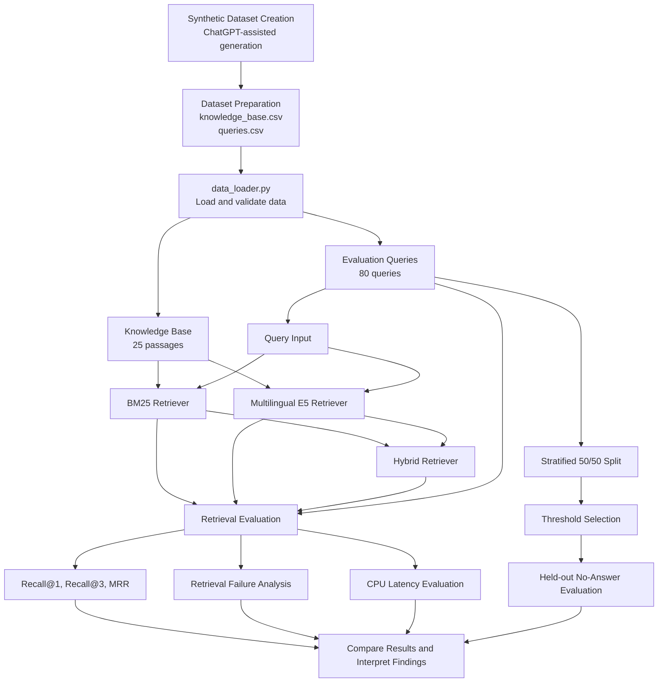

# Loan Retrieval Evaluation: BM25 vs Multilingual E5 vs Hybrid Retrieval

## 1. Project Overview

This project evaluates different information retrieval techniques for a fictional loan servicing knowledge base. The objective is to determine how effectively different retrieval systems identify the correct information when customers ask questions in English, Hinglish, or noisy speech-recognition text.

The project compares three retrieval approaches:

1. **BM25:** A traditional lexical retrieval algorithm that matches query terms against document terms.
2. **Multilingual E5:** A dense retrieval approach that represents queries and passages as numerical embeddings and compares their semantic similarity.
3. **Hybrid BM25 + E5:** A retrieval approach that combines lexical and semantic retrieval.

In addition to retrieval quality, the project evaluates CPU search latency, investigates retrieval failures, and tests whether a retrieval-score threshold can identify questions that should be refused because they are outside the knowledge base's scope.

The central objective is to understand the trade-offs between lexical matching, semantic matching, and hybrid retrieval for multilingual customer-support queries.

## 2. Problem Statement

Customers do not always phrase questions in the same way as the information stored in a knowledge base.

For example, the following questions express a similar information need:

- "What are the foreclosure charges?"
- "Loan jaldi band karne ka kitna charge lagega?"
- "For closure charges kitne hai?"

A lexical retriever may struggle when the query uses different words from the relevant passage. A semantic retriever may recognize similarities in meaning, but it can also retrieve passages about related yet different topics.

The challenge becomes more difficult when queries contain:

- Hinglish and code-switching between English and Hindi.
- Spelling mistakes and phonetic variations.
- Informal sentence structures.
- Noisy automatic speech recognition (ASR) output.
- Questions unrelated to the available knowledge base.

This project evaluates how the three retrieval systems handle these challenges and whether the retrieved results are suitable for a customer-support retrieval pipeline.

## 3. Dataset Creation and Preparation

### 3.1 How the dataset was created

ChatGPT was used as an assistance tool during the creation of the synthetic evaluation dataset. It helped generate candidate loan-servicing passages and customer queries in different linguistic styles.

The generated material was organized into structured CSV datasets for use in the evaluation pipeline.

The dataset represents a fictional company named Nivara Finance. Its company policies, charges, and servicing information are synthetic and intended exclusively for this project.

The dataset is not presented as real customer data or as the verified policy of an actual financial institution.

### 3.2 Knowledge base

The knowledge base contains 25 passages organized by topic.

Each passage has three fields:

| Field | Description |
|---|---|
| `passage_id` | Unique identifier for the passage, such as P01. |
| `topic` | Topic category, such as EMI, foreclosure, or statements. |
| `text` | The information that a retrieval system can return. |

The passages cover the following areas:

- EMI schedules and payment preparation.
- Repayment methods.
- Bounced payments.
- Foreclosure.
- Part-payment.
- Loan statements and interest certificates.
- Customer support.
- General loan servicing.

**Decision:** A small, controlled knowledge base makes it possible to evaluate retrieval behavior against known relevant passages and manually investigate errors.

However, this dataset is a prototype benchmark. Its size does not establish how well the systems would perform on a large production knowledge base.

### 3.3 Query dataset

The query dataset contains 80 queries divided into four categories.

| Query category | Number of queries | Purpose |
|---|---:|---|
| `english_clean` | 20 | Evaluate standard English queries. |
| `hinglish` | 20 | Evaluate informal Hinglish queries. |
| `asr_noisy` | 20 | Evaluate noisy, transcription-like queries. |
| `out_of_scope` | 20 | Evaluate questions that cannot be answered from the knowledge base. |
| **Total** | **80** | |

Each query contains the following fields:

| Field | Description |
|---|---|
| `query_id` | Unique query identifier. |
| `query` | Customer question. |
| `relevant_passage_id` | Expected passage ID for answerable queries. |
| `query_type` | Category used for evaluation. |

For answerable queries, `relevant_passage_id` identifies the passage considered correct for that query. For out-of-scope queries, the relevant passage is empty.

### 3.4 Why multiple query types were included

Using only clean English queries would provide an incomplete picture of retrieval performance.

The four categories help investigate different challenges:

- Clean English establishes a baseline.
- Hinglish tests cross-lingual and code-switched retrieval.
- Noisy ASR-style queries test retrieval when spelling and phrasing are imperfect.
- Out-of-scope questions test whether the system can avoid returning an apparently relevant passage when the knowledge base does not contain the required answer.

### 3.5 Ground-truth relevance

Each answerable query is associated with a designated relevant passage. This association serves as the ground truth for retrieval evaluation.

The evaluation compares the retrieved passage rankings against these expected passage IDs.

A limitation is that each query has only one designated relevant passage. In a real customer-support system, multiple passages may sometimes provide useful information for the same question.

## 4. System Architecture

The architecture follows a data-loading, retrieval, evaluation, and analysis workflow.

### 4.1 High-level architecture



The diagram represents the conceptual workflow. The exact implementation of score fusion and data validation is determined by the Python source code.

### 4.2 Step-by-step execution flow

**Step 1: Prepare the data**

ChatGPT-assisted synthetic content is organized into the knowledge-base and query CSV files.

The knowledge base stores the passages available to the retrievers. The query dataset stores the customer questions and their expected relevant passages.

**Step 2: Load and validate the datasets**

`data_loader.py` loads the knowledge base and query dataset into Python data structures.

The evaluation checks that the expected datasets and fields are available and reports the dataset sizes and query distribution.

**Step 3: Initialize BM25**

`BM25Retriever` prepares a lexical search index over the knowledge-base passages.

When a customer submits a query, BM25 ranks passages using term-matching signals, including term frequency and inverse document frequency.

This approach is useful when the query and the passage share important words or phrases.

**Step 4: Initialize multilingual E5**

`EmbeddingRetriever` loads a multilingual E5 embedding model and prepares embeddings for the knowledge-base passages.

The query is also encoded into an embedding. The retriever then compares the query representation with the passage representations to identify semantically similar passages.

This approach can help when the wording of the query differs from the wording of the relevant passage.

**Step 5: Initialize hybrid retrieval**

`HybridRetriever` combines the BM25 and multilingual E5 retrieval approaches.

The purpose is to investigate whether lexical and semantic signals complement each other.

The exact fusion formula, score normalization, and ranking procedure depend on the implementation in `retrievers.py`. A hybrid system should not be assumed to outperform its individual components without experimental evidence.

**Step 6: Evaluate retrieval quality**

`evaluate.py` runs the retrieval evaluation for each system.

For answerable queries, the retrieved rankings are compared with the expected relevant passage IDs.

The evaluation reports Recall@1, Recall@3, and Mean Reciprocal Rank for each query category.

**Step 7: Measure CPU search latency**

The selected hybrid retriever is measured after a warm-up search.

The measurement includes query embedding generation where applicable but excludes model initialization.

The 95th-percentile latency is compared with a target of 150 milliseconds.

**Step 8: Select a no-answer threshold**

The query dataset is divided into a reproducible, stratified 50/50 selection and test split.

The selection split is used to choose a retrieval-score threshold by maximizing balanced accuracy.

If the highest retrieval score for a query falls below the selected threshold, the query is classified as requiring refusal.

**Step 9: Evaluate refusal behavior**

The selected threshold is applied to the held-out test split.

The evaluation measures the proportion of out-of-scope queries correctly refused and the proportion of answerable queries incorrectly refused.

**Step 10: Analyze retrieval failures**

The evaluation identifies answerable queries for which the correct passage does not appear in the top three retrieved results.

Examining these failures helps identify weaknesses in ranking, query wording, and the distinction between closely related topics.

**Step 11: Compare and interpret the results**

`compare_results.py` presents a side-by-side comparison of the retrieval systems.

The metrics are used to determine which approach performs best overall and which approach performs best for individual query categories.

## 5. Technical Components and Design Decisions

| Component | Purpose | Reason for inclusion |
|---|---|---|
| Python | Main implementation language | Supports data processing, model inference, and evaluation. |
| Pandas | Dataset loading and manipulation | Makes it easier to process structured CSV datasets and query categories. |
| NumPy | Numerical calculations | Supports percentile-based latency calculations and other numerical operations. |
| BM25 | Lexical retrieval baseline | Establishes how well direct term matching performs. |
| Multilingual E5 | Dense semantic retrieval | Tests semantic matching across different query formulations and languages. |
| Hybrid retrieval | Combined retrieval experiment | Investigates whether lexical and semantic signals provide complementary benefits. |
| CSV | Dataset storage | Provides a simple, inspectable format for passages, queries, and labels. |
| Python timing utilities | Latency measurement | Measures search execution time without including model initialization. |

### Why compare three retrieval approaches?

Using only one retrieval method would make it difficult to understand the benefits and limitations of different ranking strategies.

BM25 provides a lexical baseline. Multilingual E5 provides a semantic baseline. Hybrid retrieval tests whether the two approaches can complement one another.

This comparison makes it possible to select a retrieval strategy based on measured performance rather than assuming that a more complex method is automatically better.

## 6. Evaluation Metrics

### 6.1 Recall@1

Recall@1 measures how often the expected relevant passage appears at rank 1.

For this single-relevant-passage evaluation, it is the proportion of answerable queries whose correct passage is the first result.

### 6.2 Recall@3

Recall@3 measures how often the expected relevant passage appears anywhere within the first three results.

This metric is useful when a downstream application can inspect multiple retrieved passages instead of relying exclusively on the top result.

### 6.3 Mean Reciprocal Rank

Mean Reciprocal Rank (MRR) measures how highly the correct passage is ranked.

A correct result at rank 1 receives a reciprocal rank of 1. A correct result at rank 2 receives 1/2, and a correct result at rank 3 receives 1/3. If the correct passage is not retrieved within the evaluated ranking, its reciprocal rank is zero.

Higher MRR indicates that relevant passages tend to appear closer to the top.

### 6.4 Macro-average

The reported macro-average is calculated by averaging the metric values across the three answerable query categories:

- `english_clean`
- `hinglish`
- `asr_noisy`

Each category receives equal weight, irrespective of differences in category size.

Out-of-scope queries are excluded from these standard retrieval metrics because they do not have a designated relevant passage.

## 7. Retrieval Results

The following values are from the recorded evaluation run.

### 7.1 Clean English

| System | Recall@1 | Recall@3 | MRR |
|---|---:|---:|---:|
| BM25 | 0.850 | 1.000 | 0.925 |
| Multilingual E5 | 0.850 | 0.950 | 0.897 |
| Hybrid BM25 + E5 | 0.800 | 0.950 | 0.887 |

**Interpretation:** BM25 performs particularly well on clean English queries, achieving perfect Recall@3 in this run. This suggests that lexical matching is effective when query wording closely matches the knowledge-base language.

### 7.2 Hinglish

| System | Recall@1 | Recall@3 | MRR |
|---|---:|---:|---:|
| BM25 | 0.500 | 0.600 | 0.610 |
| Multilingual E5 | 0.650 | 0.850 | 0.750 |
| Hybrid BM25 + E5 | 0.400 | 0.700 | 0.605 |

**Interpretation:** Multilingual E5 performs best on Hinglish queries in this run. Its higher Recall@3 indicates that it retrieves the expected passage more consistently despite variations in wording.

The current hybrid configuration does not improve on the dense retriever for this category.

### 7.3 Noisy ASR-style queries

| System | Recall@1 | Recall@3 | MRR |
|---|---:|---:|---:|
| BM25 | 0.600 | 0.850 | 0.742 |
| Multilingual E5 | 0.600 | 0.800 | 0.739 |
| Hybrid BM25 + E5 | 0.600 | 0.850 | 0.739 |

**Interpretation:** BM25 and the hybrid system achieve the same Recall@1 and Recall@3 values in this run. The dense retriever has the same Recall@1 but a lower Recall@3.

The results show that the benefit of semantic retrieval depends on the query category.

### 7.4 Overall macro-average

| System | Recall@1 | Recall@3 | MRR |
|---|---:|---:|---:|
| BM25 | 0.650 | 0.817 | 0.759 |
| Multilingual E5 | 0.700 | 0.867 | 0.795 |
| Hybrid BM25 + E5 | 0.600 | 0.833 | 0.744 |

**Interpretation:** Multilingual E5 achieves the strongest macro-average performance across the three answerable query categories in this recorded run.

BM25 remains competitive on clean English and noisy ASR-style queries. The hybrid implementation does not consistently outperform either individual retriever.

The result illustrates an important engineering principle: combining retrieval methods only helps when their scores and rankings are combined effectively.

## 8. CPU Latency Evaluation

The hybrid retriever was evaluated using warm CPU search measurements.

| Measurement | Recorded result |
|---|---:|
| Queries measured | 80 |
| Warm-search p95 latency | 38.99 ms |
| Target latency | 150 ms |
| Recorded outcome | Within target |

The observed 95th-percentile latency is below the 150 ms target.

This measurement excludes model initialization and includes query embedding generation where applicable.

**Decision:** CPU latency was measured separately from retrieval quality because a system needs to be both accurate and responsive. A system that retrieves the right passage but takes too long to respond may not be suitable for interactive customer support.

These measurements apply to the recorded environment and should not be interpreted as a production performance guarantee.

## 9. No-Answer Threshold Evaluation

### 9.1 Why a no-answer threshold is necessary

A retrieval system may always return a top-ranked passage, even when the customer's question is outside the knowledge base.

For example, a question about a new loan's interest rate might retrieve a passage about an existing loan's repayment terms. The returned passage may have some textual or semantic similarity without actually answering the question.

A score-based threshold provides a simple mechanism for identifying queries whose retrieval scores are too low to justify returning an answer.

### 9.2 Threshold selection methodology

The implementation uses a reproducible, stratified 50/50 split.

The selection split is used to find the threshold that maximizes balanced accuracy. The held-out split is then used to evaluate the selected threshold.

Balanced accuracy gives equal weight to:

- The proportion of out-of-scope queries correctly refused.
- The proportion of answerable queries correctly accepted.

This helps prevent the threshold-selection objective from favoring one class simply because it contains more examples.

### 9.3 Recorded results

| Measurement | Result |
|---|---:|
| Threshold-selection queries | 40 |
| Held-out test queries | 40 |
| Selection balanced accuracy | 0.817 |
| Selected threshold | 0.03226226 |
| Out-of-scope queries correctly refused | 6/10 (60.0%) |
| Answerable queries wrongly refused | 4/30 (13.3%) |

### 9.4 Interpretation

The threshold correctly refuses 60% of the held-out out-of-scope queries. However, it fails to refuse the remaining 40%.

It also incorrectly refuses 13.3% of the held-out answerable queries.

These results show that a single retrieval-score threshold is not sufficient for reliable refusal behavior in the current setup.

The threshold is specific to the chosen retriever, score distribution, and evaluation dataset. It should not be treated as a calibrated probability of correctness.

The dataset is also small, so these percentages are preliminary estimates rather than strong evidence of production performance.

## 10. Retrieval Failure Analysis

The failure analysis identifies answerable queries for which the expected passage does not appear in the top three results.

Examples from the recorded run are shown below.

| Query ID | Query | Expected passage | Retrieved top three |
|---|---|---|---|
| q008 | Can I pay my EMI in cash at a branch? | P08 | P03, P20, P11 |
| q021 | Mera EMI har mahine kis date ko katega? | P01 | P03, P02, P04 |
| q026 | Online loan repayment kaise karun? | P06 | P07, P08, P11 |
| q032 | Loan jaldi band karne ka kitna charge lagega? | P12 | P10, P17, P15 |
| q049 | emi bounce matlab payment fail hua na | P09 | P10, P20, P04 |

These examples illustrate several potential failure patterns.

### 10.1 Closely related passages

The retriever may rank a passage about a related servicing issue above the passage that directly answers the question.

For example, a question about a bounced EMI may retrieve a passage about the bounce fee instead of the passage defining a bounced EMI.

### 10.2 Informal wording and code-switching

Hinglish questions may use different words from the corresponding English passages.

A question about closing a loan early may use the phrase "loan jaldi band karna," while the knowledge base uses "foreclosure." A retriever must connect these formulations to the same information need.

### 10.3 Ambiguous retrieval signals

A passage may share general terms such as "payment," "loan," or "account" with a query without addressing its specific intent.

This can cause a related but incorrect passage to appear near the top.

### 10.4 Potential improvements

Possible next experiments include:

- Tuning the hybrid score-fusion strategy.
- Normalizing lexical and semantic scores before combining them, where appropriate.
- Adding more representative Hinglish and noisy-query examples.
- Increasing the number and diversity of evaluated queries.
- Investigating a reranking stage for the top retrieved passages.
- Evaluating multiple relevant passages where appropriate.
- Testing the refusal mechanism with additional out-of-scope questions.

These are proposed improvements, not features claimed to be implemented in the current version.

## 11. Important Design Decisions

The project follows several deliberate evaluation decisions.

### Decision 1: Use a controlled synthetic dataset

A small synthetic dataset provides known passage IDs and explicit query categories, making initial evaluation and failure investigation manageable.

The trade-off is that synthetic questions may not capture the full variety of real customer language.

### Decision 2: Keep lexical and semantic baselines separate

BM25 and multilingual E5 are evaluated independently before assessing hybrid retrieval.

This makes it possible to determine whether the hybrid approach actually improves on either component.

### Decision 3: Evaluate by query category

A single aggregate metric could conceal weaknesses in Hinglish or noisy ASR queries.

Reporting metrics separately makes these differences visible.

### Decision 4: Measure latency independently

Retrieval quality and response speed are separate system requirements. The evaluation therefore includes a dedicated latency measurement.

### Decision 5: Separate threshold selection from threshold evaluation

The threshold is selected using one split and evaluated using a separate held-out split.

This reduces the risk of reporting overly optimistic refusal results caused by evaluating the threshold on the same examples used to select it.

### Decision 6: Investigate failures rather than relying only on aggregate metrics

Aggregate scores show the overall pattern, but individual failed queries reveal why a retriever may select the wrong passage.

This analysis provides a practical basis for deciding what to improve next.

## 12. Project Limitations

The current implementation has several limitations:

1. **Small knowledge base:** Only 25 passages are available.
2. **Limited query count:** Each query category contains only 20 examples.
3. **Single designated relevant passage:** Other passages that might also be useful are not captured by the current labels.
4. **Synthetic language distribution:** The dataset may not fully represent real customer questions or real ASR errors.
5. **Hybrid retrieval limitations:** The current hybrid configuration does not consistently outperform its individual components.
6. **Threshold reliability:** The held-out refusal evaluation contains only 40 queries, including 10 out-of-scope queries.
7. **Score calibration:** Retrieval scores are not calibrated probabilities of answer correctness.
8. **Latency generalization:** The measured latency depends on the execution environment and does not guarantee the same performance in production.
9. **No production validation:** The experiment does not establish real-world accuracy, customer outcomes, or compliance with any actual financial institution's policies.

These limitations should be considered when interpreting the results.

## 13. How to Run the Project

Run the evaluation from the project directory:

```bash
python evaluate.py
```

This runs the retrieval evaluation and, depending on the enabled functionality in the current implementation, reports latency, threshold-selection results, and retrieval failures.

Run the system comparison:

```bash
python compare_results.py
```

This compares BM25, multilingual E5, and hybrid retrieval across the answerable query categories.

Ensure that the required Python dependencies are installed and that the expected CSV files are present before running either script.

## 14. Project Structure

The following is the expected logical organization of the project. Actual filenames should match the files present in the repository.

```text
loan-retrieval-evaluation/
│
├── data/
│   ├── knowledge_base.csv
│   └── queries.csv
│
├── data_loader.py
├── retrievers.py
├── metrics.py
├── evaluate.py
├── compare_results.py
└── README.md
```

- `data/`: Stores the synthetic knowledge base and evaluation queries.
- `data_loader.py`: Loads the datasets and performs the implemented validation.
- `retrievers.py`: Contains the BM25, multilingual E5, and hybrid retrieval implementations.
- `metrics.py`: Contains the retrieval metric calculations and reporting functions.
- `evaluate.py`: Runs the main evaluation workflow.
- `compare_results.py`: Presents a side-by-side comparison of retrieval systems.
- `README.md`: Documents the methodology, architecture, results, and limitations.

If the CSV files are stored in a different location in the actual repository, update this section to reflect the real folder structure.

## 15. Conclusion

This project establishes an experimental framework for comparing lexical, semantic, and hybrid retrieval over a multilingual loan-servicing knowledge base.

The recorded results show that multilingual E5 achieves the strongest macro-average Recall@1, Recall@3, and MRR in the current experiment. BM25 performs particularly well on clean English queries, while performance varies across Hinglish and noisy ASR-style queries.

The recorded hybrid CPU latency meets the 150 ms target. The no-answer evaluation, however, shows that retrieval-score thresholding still misses some out-of-scope questions and incorrectly refuses some answerable ones.

The primary conclusion is that retrieval methods must be evaluated against the intended query distribution rather than selected based on assumptions about model complexity.

Future work should focus on improving hybrid ranking, broadening the evaluation dataset, refining the refusal mechanism, and validating the results on a more representative set of customer-support queries.

**The current implementation should be considered an evaluation prototype rather than a production-ready financial customer-support system.**